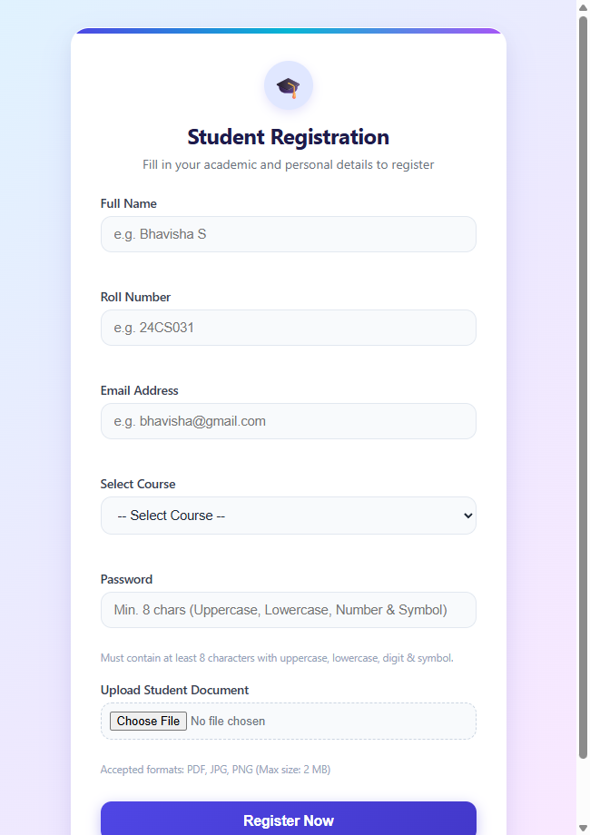
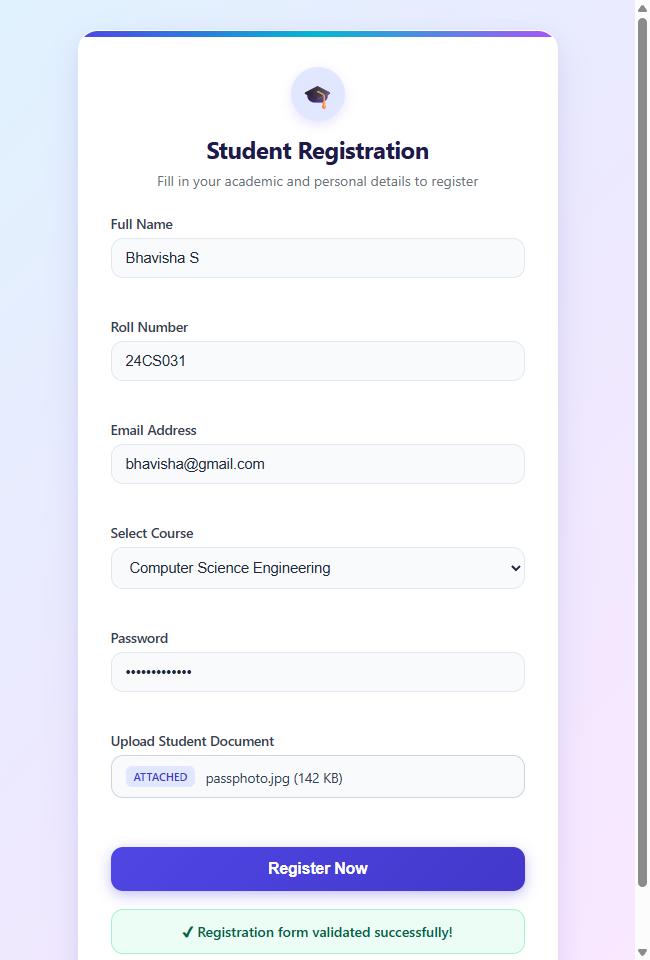
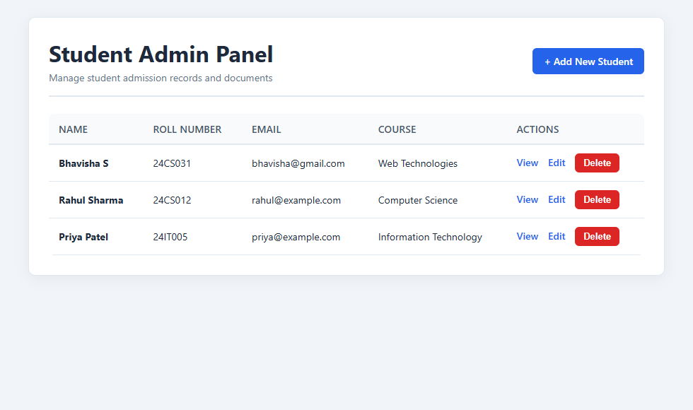
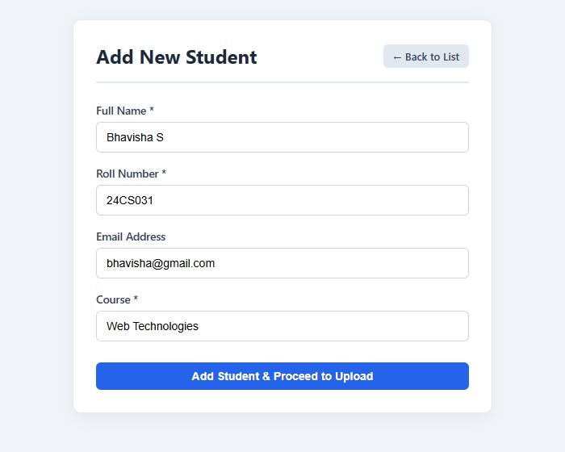
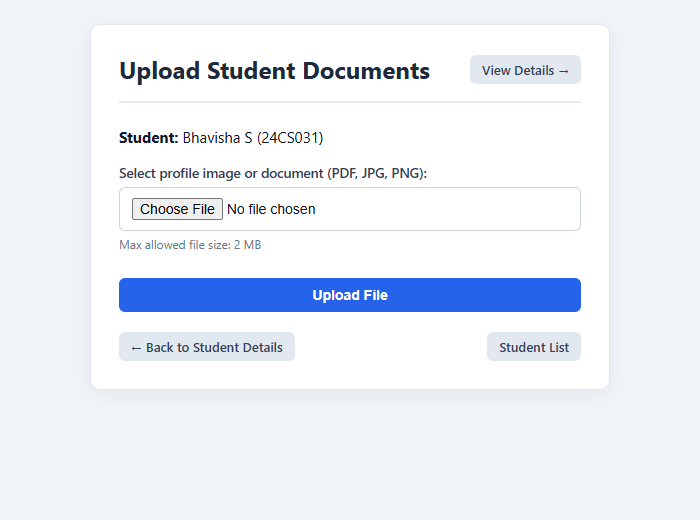
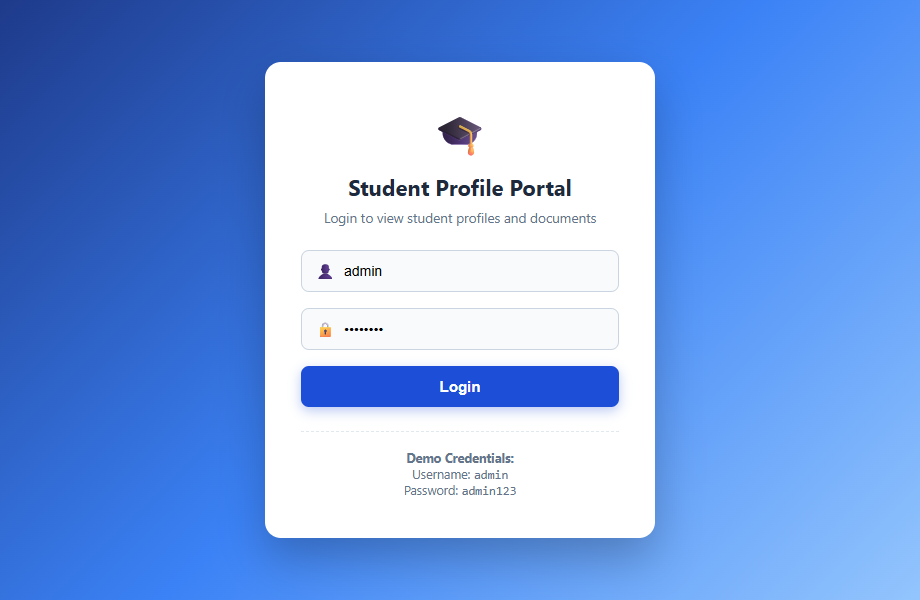
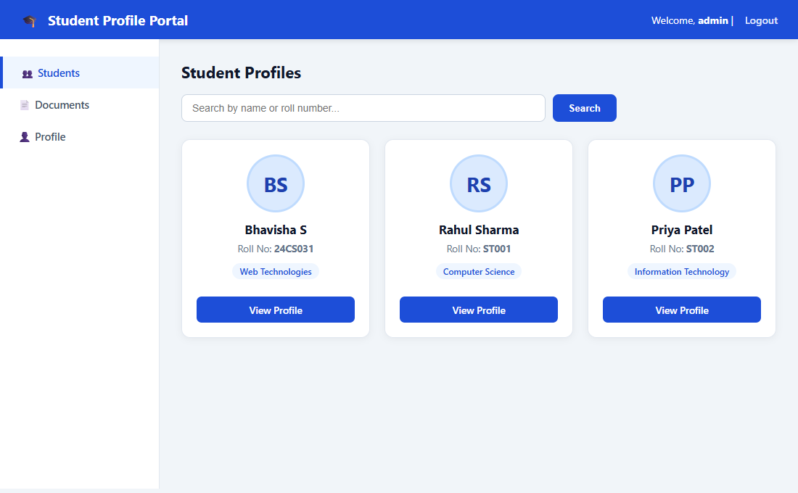
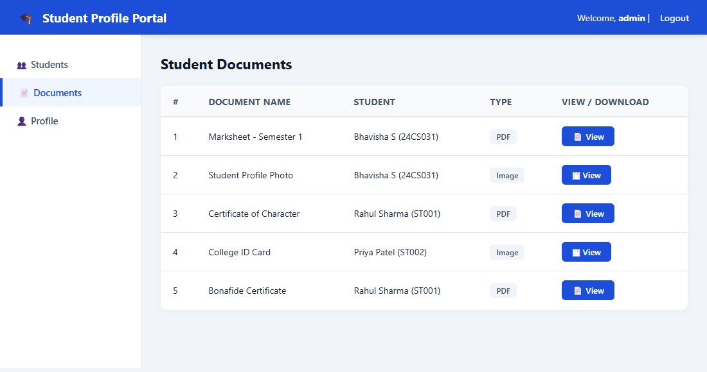

# Web Technology – Assignment 2 (U21CS501)


-indigo?style=for-the-badge)

---

## 📌 Student & Submission Details
- **Student Name:** Bhavisha S
- **Roll Number:** 24CS031
- **Course Code & Name:** U21CS501 – Web Technology
- **Repository URL:** [https://github.com/Bhavisha1107/WT-Assignment-2](https://github.com/Bhavisha1107/WT-Assignment-2)
- **Document Report:** [`Assignment-2_Web_Technology_Bhavisha_S_24CS031.docx`](./Assignment-2_Web_Technology_Bhavisha_S_24CS031.docx)

---

## 📂 Project Structure

```text
WT-Assignment-2/
│
├── Question-1_Student_Registration/
│   ├── index.html            # Registration form layout with semantic HTML5
│   ├── style.css             # Modern responsive styling & visual feedback
│   ├── validation.js         # Client-side form & password regex validation
│   └── script.js             # Script mirror
│
├── Question-2_PHP_Admin_Panel/
│   ├── db.php                # PDO database connection & XSS escaping
│   ├── index.php             # Student records dashboard (Read/Delete)
│   ├── add.php               # Student record creation (Create)
│   ├── edit.php              # Student record modification (Update)
│   ├── delete.php            # Secure POST-based deletion with file cleanup
│   ├── upload.php            # Document & image upload with MIME validation
│   ├── view.php              # Student record viewer with document previews
│   ├── style.css             # Admin dashboard UI styling
│   ├── student_admin.sql     # Database schema and seed records
│   └── uploads/              # Uploaded document directory (.gitkeep)
│
├── Question-3_Java_Servlet_Portal/
│   ├── pom.xml               # Maven configuration (Jakarta EE 6, MySQL Driver, JSTL)
│   ├── database.sql          # MySQL database schema and sample records
│   └── src/main/
│       ├── java/com/college/
│       │   ├── DBConnection.java     # JDBC connection pool configuration
│       │   ├── Student.java          # Student entity model
│       │   ├── StudentFile.java      # Student document metadata model
│       │   ├── LoginServlet.java     # Authentication controller
│       │   ├── LogoutServlet.java    # Session termination controller
│       │   ├── StudentServlet.java   # Profile directory retrieval controller
│       │   └── FileServlet.java      # Secure binary document stream controller
│       └── webapp/
│           ├── WEB-INF/web.xml       # Servlet 6.0 deployment descriptor
│           ├── login.jsp             # Secure admin authentication interface
│           └── students.jsp          # Dynamic student profile directory view
│
├── output_screenshots/               # High-resolution screenshots of all 3 questions
│   ├── q1_empty.png
│   ├── q1_filled.png
│   ├── q2_index.png
│   ├── q2_add.png
│   ├── q2_upload.png
│   ├── q3_login.png
│   ├── q3_students.png
│   └── q3_documents.png
│
├── Assignment-2_Web_Technology_Bhavisha_S_24CS031.docx  # Word document report
├── generate_docx.py                  # Automated Word document generator script
└── README.md                         # Project documentation
```

---

## 🚀 Question 1: Student Admission Registration Form

### 📝 Scenario & Task
Build a responsive student registration form featuring client-side validation for:
1. **Mandatory Fields:** Name, Roll Number, Course selection, Password, Document Upload.
2. **Email Formatting:** Strict regular expression pattern match.
3. **Password Strength:** Minimum 8 characters including uppercase, lowercase, numeric digit, and special characters (`@$!%*?&`).
4. **File Verification:** Max 2 MB, strictly `.pdf`, `.jpg`, `.jpeg`, or `.png`.

### 🖼️ Output Screenshots
| Initial Form State | Validated Form with Success State |
| :---: | :---: |
|  |  |

### 💻 How to Run
Simply open `Question-1_Student_Registration/index.html` in any modern web browser (Google Chrome, Microsoft Edge, Mozilla Firefox).

---

## ⚙️ Question 2: College Admin Panel (PHP + MySQL CRUD & File Upload)

### 📝 Scenario & Task
Develop a PHP admin panel that supports full CRUD operations on student records and manages student documents:
1. **CRUD Operations:** Add, Edit, Delete, and View student details.
2. **File Upload Handling:** Upload student ID proofs and certificates (PDF, JPG, PNG).
3. **Database Metadata Storage:** Store file path, MIME type, upload timestamp, and original file name.
4. **Secure Implementation:** PDO prepared statements (anti-SQLi), `htmlspecialchars()` (anti-XSS), unique filename generation via `random_bytes()`, and strict MIME validation using `finfo`.

### 🖼️ Output Screenshots
| Admin Dashboard List | Add Student Form | Document Upload Handling |
| :---: | :---: | :---: |
|  |  |  |

### 💻 How to Run
1. Start **Apache** and **MySQL** in XAMPP / WampServer.
2. Open phpMyAdmin (`http://localhost/phpmyadmin/`) and import `Question-2_PHP_Admin_Panel/student_admin.sql`.
3. Copy the `Question-2_PHP_Admin_Panel` folder to your server's `htdocs` directory (e.g., `C:/xampp/htdocs/student_admin/`).
4. Access `http://localhost/student_admin/index.php` in your browser.

---

## ☕ Question 3: Student Profile Portal (Java Servlets, JSP & JDBC)

### 📝 Scenario & Task
Develop a Java enterprise web application using Jakarta Servlets, JSP, JSTL, and JDBC:
1. **JDBC Integration:** Connects to MySQL (`student_portal` database) to retrieve student profiles and file attachments.
2. **Binary Document Streaming (`FileServlet`):** Streams images and PDF files securely from a protected folder without exposing direct server paths.
3. **Dynamic Presentation (`students.jsp`):** Displays student profiles in responsive cards with profile images and PDF links using JSTL `<c:forEach>` loops.
4. **Session Management:** Enforces authentication via `LoginServlet` (`admin` / `admin123`) and invalidation via `LogoutServlet`.

### 🖼️ Output Screenshots
| Secure Login Screen | Student Profile Directory | Document Repository View |
| :---: | :---: | :---: |
|  |  |  |

### 💻 How to Run
1. Import `Question-3_Java_Servlet_Portal/database.sql` into MySQL.
2. Build the project using Maven:
   ```bash
   mvn clean package
   ```
3. Deploy the resulting `target/StudentPortal.war` file into Apache Tomcat 10+ `webapps/` folder.
4. Open `http://localhost:8080/StudentPortal/` in your browser.
5. Log in using:
   - **Username:** `admin`
   - **Password:** `admin123`

---

## 🔐 Security Best Practices Implemented
- **SQL Injection Prevention:** 100% prepared statements using PDO in PHP and `PreparedStatement` in Java.
- **Cross-Site Scripting (XSS) Prevention:** Output escaping via `htmlspecialchars(..., ENT_QUOTES, "UTF-8")` in PHP and `<c:out value="..."/>` in JSP.
- **Directory Traversal Protection:** Normalized and sandboxed path resolution in `FileServlet` and PHP upload handlers.
- **Session Fixation Defense:** Dynamic session ID regeneration upon successful authentication via `request.changeSessionId()`.

---

## 📄 License & Attribution
Developed for **U21CS501 – Web Technology Assignment 2** by **Bhavisha S (Roll: 24CS031)**.
